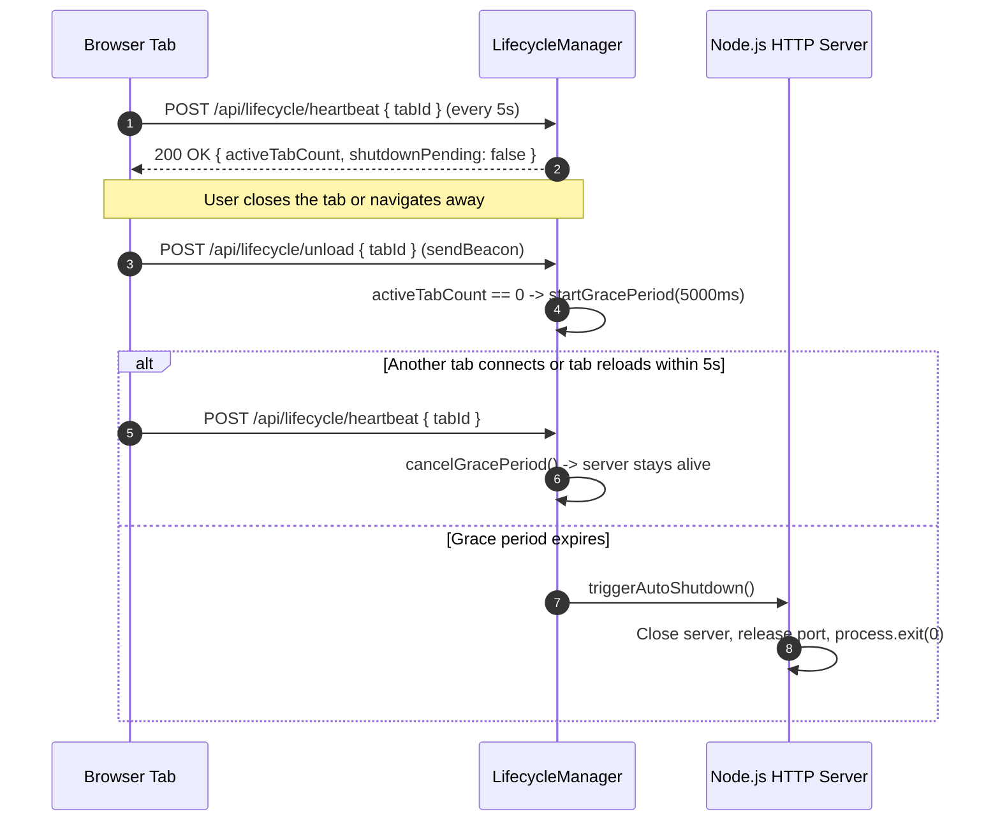
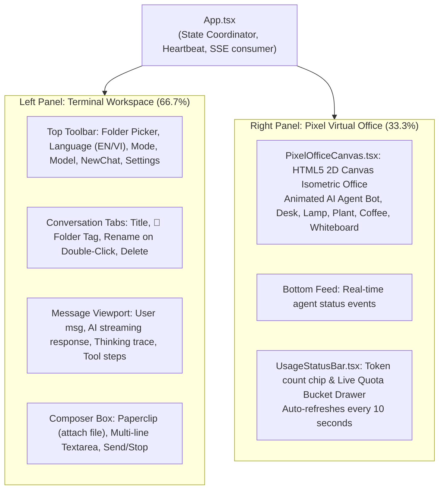

# PROJECT CONTEXT & ARCHITECTURAL SPECIFICATION
> **Document Purpose**: Complete architectural, design, and implementation specification for **The Virtual Office for Your Work**. This document is specifically structured so that any AI model or engineer reading it can immediately grasp the full scope, design invariants, data flows, and code patterns to implement modifications rapidly and without regressions.

---

## 1. Executive Summary & Core Philosophy

**The Virtual Office for Your Work** is an offline-first, local-only developer desktop environment on Windows that blends an **AI Coding Terminal** with a retro 8-bit/16-bit **Pixel-Art Virtual Office**.

### Key Architectural Invariants:
1. **Zero External Cloud Server Dependencies**:
   - The backend runs entirely as a local Node.js process bound strictly to loopback (`127.0.0.1`).
   - Foreign HTTP `Host` or `Origin` headers are immediately rejected with `403 Forbidden`.
   - No analytics, telemetry, or remote servers are called.
2. **Real Antigravity CLI Integration (`agy.exe`)**:
   - Pairs directly with Google's local `agy.exe` (v1.4.4+) installed on the host machine.
   - Streams live NDJSON turns via `agy -p "<prompt>" --output-format stream-json`.
   - Fetches authentic quota and token metrics via `agy -p "/usage" --output-format json`.
   - Never fabricates fake metrics. If a metric cannot be determined, it is explicitly reported as `UNSUPPORTED` or `UNAVAILABLE`.
3. **Tab-Heartbeat Driven Process Lifecycle**:
   - The local server stays alive *only* while at least one browser tab is active.
   - Browser tabs send continuous heartbeats every 5 seconds and issue `navigator.sendBeacon('/api/lifecycle/unload')` on tab close/unload.
   - When the final tab disconnects, a 5-second grace period starts. If no tab reconnects within that period, the backend automatically terminates its process (`process.exit(0)`) and frees the loopback port.
4. **General Chat vs. Project Workspace Dual-Mode**:
   - **New Chat (`+`)** defaults to an empty folder (`projectPath: null`). The session runs in an isolated, clean directory (`%LOCALAPPDATA%\VirtualOffice\workspace-general`) without seeing or interfering with any project files.
   - **Project Mode**: When a user selects a local folder, the chat binds to that folder. Antigravity executes with `cwd = projectFolder`, enabling file attachments, codebase analysis, and code modifications.
   - **Per-Tab Memory**: Switching tabs automatically switches the active folder context in the UI and backend.
5. **Self-Contained Windows Distribution**:
   - One-click launcher (`start-virtual-office.bat`) starts backend and opens default browser.
   - Standalone Windows installer (`VirtualOffice-Setup.exe`) compiled via `.NET` (`csc.exe`) with embedded Node.js runtime and custom pixel-art icon (`app.ico`). Requires no pre-installed dependencies.

---

## 2. Directory Structure & File Map

```
C:\Duzg\Project\VirtualOffice\
├── app.ico                                  # Handcrafted multi-resolution Windows icon (16-256px)
├── index.html                               # HTML5 entry with retro typography (Silkscreen/Pixelify)
├── package.json                             # Dependencies & scripts
├── tsconfig.json                            # TypeScript configuration
├── vite.config.ts                           # Vite configuration for React client
├── start-virtual-office.bat                 # One-click Windows launcher (calls scripts/launcher.ps1)
├── The Virtual Office for Your Work.lnk     # Windows Desktop shortcut pointing to launcher
├── PROJECT_CONTEXT.md                       # This consolidated AI architecture guide
├── README.md                                # User manual (English)
├── README_VN.md                             # User manual (Vietnamese)
│
├── dist/                                    # Compiled production output
│   ├── client/                              # Production client bundle (HTML, JS, CSS, SVG)
│   └── server/index.mjs                     # Bundled zero-dependency backend
│
├── dist-release/                            # Packaging build targets
│   ├── VirtualOffice-Portable/              # Unpacked portable distribution with runtime/node.exe
│   └── VirtualOffice-Setup.exe              # Self-contained native Windows installer
│
├── public/                                  # Static assets
│   └── assets/
│       ├── app.ico                          # Pixel icon for web tab favicon
│       └── pixel-logo.svg                   # Vector pixel branding logo
│
├── scripts/
│   ├── build-server.mjs                     # esbuild script bundling src/server/ into dist/server/index.mjs
│   ├── create-desktop-shortcut.ps1          # PowerShell utility generating Windows Desktop .lnk with app.ico
│   ├── generate-pixel-icon.mjs              # Standalone Win32-compliant .ico binary builder (16-256px BMP)
│   ├── launcher.ps1                         # Background process manager & default browser launcher
│   └── package-windows.mjs                  # Compiles C# installer & bundles standalone portable runtime
│
├── src/
│   ├── shared/
│   │   └── types.ts                         # Universal TypeScript definitions shared by client & server
│   │
│   ├── server/
│   │   ├── index.ts                         # HTTP/SSE server, loopback security, REST endpoints
│   │   ├── agyAdapter.ts                    # Antigravity CLI (agy.exe) wrapper, stream parser, /usage cache
│   │   ├── demoAdapter.ts                   # Simulated offline fallback adapter for demo mode
│   │   ├── lifecycleManager.ts              # Tab session heartbeats, sweep timer, automatic shutdown
│   │   ├── projectManager.ts                # Windows folder browse, drive letters, Unicode path validator
│   │   └── storage.ts                       # AppData persistence (%LOCALAPPDATA%\VirtualOffice\)
│   │
│   └── client/
│       ├── App.tsx                          # Root React component, state coordinator, SSE consumer
│       ├── i18n.ts                          # English and Vietnamese bilingual dictionary
│       ├── styles.css                       # Retro pixel design system, 3D button bevels, squared scrollbars
│       └── components/
│           ├── DirectoryModal.tsx           # Windows folder picker modal (drives, tree, manual path)
│           ├── PixelOfficeCanvas.tsx        # HTML5 Canvas 2D isometric pixel-art office simulation
│           ├── TerminalWorkspace.tsx        # Left panel: tabs, streaming chat messages, token chips
│           └── UsageStatusBar.tsx           # Bottom-right token usage badge & quota drawer
│
└── tests/
    ├── packaging-and-live.test.mjs          # Test: Installer extraction, Unicode folder, live agy.exe
    └── virtual-office.test.mjs              # Test: Loopback security, lifecycle, multi-tab, Unicode folders
```

---

## 3. Core Architectural Subsystems

### 3.1. Tab Heartbeat & Automatic Process Lifecycle (`lifecycleManager.ts`)



- Each browser tab generates a unique `tabId` (e.g. `tab-1729560000000-xxxx`).
- Stale sessions that fail to heartbeat within 25 seconds (e.g., browser hard crash) are automatically swept and pruned.
- The server port (`preferredPort: 48911` with automatic conflict hunting up to `48925`) is cleanly released on exit.

### 3.2. Real Antigravity CLI Adapter (`agyAdapter.ts`)

- **Binary Resolution**: Checks `C:\Users\<User>\.gemini\antigravity-cli\bin\agy.exe` and system `PATH`.
- **Streaming Invocations**:
  ```bash
  agy.exe -p "<prompt>" --output-format stream-json [--mode accept-edits | --dangerously-skip-permissions]
  ```
  - Parses incoming NDJSON chunks:
    - `init`: extracts conversation ID, model, and active `cwd`.
    - `step_update.thinking_delta`: emitted into `onThinkingDelta`.
    - `step_update.text_delta`: emitted into `onTextDelta`.
    - `step_update.tool`: tracks tool steps (state: `ACTIVE` -> `DONE` or `ERROR`).
    - `result`: captures final usage tokens (`input_tokens`, `output_tokens`, `thinking_tokens`, `cache_read_tokens`, `total_tokens`).
- **Quota Polling (`/usage`)**:
  - Executes `agy.exe -p "/usage" --output-format json`.
  - Parses quota groups (`Gemini Models`, `Claude and GPT models`, etc.), percentage remaining, and reset timestamps.
  - Implements **in-flight promise deduplication** and a **3-second snapshot cache** so that frequent 10s auto-refresh intervals never spawn duplicate sub-processes.
- **General Chat Workspace Isolation**:
  - When `options.projectDir` is `null` or empty:
    `cwd` defaults to `%LOCALAPPDATA%\VirtualOffice\workspace-general`.
  - This prevents `agy.exe` from reading the application's own source code files during general reasoning or chat turns.

### 3.3. Simulated Demo Adapter (`demoAdapter.ts`)

- Fully independent offline fallback accessible via top toolbar toggle (`[Real AGY CLI / Demo Mode]`).
- All outputs, activities, and messages are explicitly badged `[DEMO MODE — SIMULATED]`.
- Generates simulated thinking traces and synthetic tool execution steps.
- Reports zero token metrics (`inputTokens: 0, outputTokens: 0`) and `isSimulated: true`. Never fabricates quota numbers.

### 3.4. Project Management & Unicode Support (`projectManager.ts`)

- Validates directory paths across Windows drives (`C:\`, `D:\`, etc.).
- Robustly handles spaces, parentheses, and full Vietnamese Unicode diacritics (e.g., `C:\Dự Án Tiếng Việt - Kiểm Thử 2026\`).
- Strictly rejects directory traversal attempts (`..\`) and non-existent paths.
- Provides native Windows Folder Browser dialog integration using headless PowerShell COM `FolderBrowserDialog` or `Shell.Application.BrowseForFolder`.

### 3.5. Storage & Persistence (`storage.ts`)

- Dedicated data directory at `%LOCALAPPDATA%\VirtualOffice\`:
  - `config.json`: user preferences (preferred adapter, language, split ratio, model, permission policy).
  - `conversations.json`: full chat history, message cards, timestamps, tool steps, and per-tab folder bindings.
  - `recent-projects.json`: history of the last 8 selected project directories.
  - `server.log`: local audit logs.

---

## 4. Frontend Component Breakdown



### 4.1. `App.tsx`
- Holds centralized state: `settings`, `selectedProject`, `conversations`, `activeConvId`, `agentConnectionStatus`, `agentActivityState`, `usageInformation`.
- Heartbeat loop: `setInterval` sending tab heartbeat to `/api/lifecycle/heartbeat` every 5 seconds.
- Per-Tab Folder Synchronization:
  - `handleNewConversation()`: Creates a conversation with `projectPath: null` and sets `selectedProject(null)`.
  - `handleSelectConversation(convId)`: Switches active conversation and syncs `selectedProject` to match the conversation's `projectPath`.
  - `handleSelectProjectPath(path)`: Updates `selectedProject` AND binds `activeConversation.projectPath = path`.
  - `handleClearProject()`: Clears `selectedProject` and resets `activeConversation.projectPath = null`.
- 10-Second Quota Auto-Refresh:
  - `setInterval(..., 10000)` calls `refreshUsage()`.
  - Uses `usageLoadingRef` guard to prevent overlapping fetch requests.

### 4.2. `TerminalWorkspace.tsx`
- **Tabs**: Displays session title and folder badge (`📁 ProjectName` or `💬`). Double-click or edit icon toggles inline rename input (`Enter` to save, `Escape` to cancel).
- **Composer**: Clean and minimal. Textarea placeholder displays `Type a message... (Enter to send, Shift+Enter for newline)`.
- **File Attachments**: Paperclip icon opens list of top-level project files. If no project is selected, clicking it opens the folder picker dialog.
- **Notice Bar**: Only rendered if the current project folder is inaccessible or missing. Completely silent during General Chat mode.

### 4.3. `PixelOfficeCanvas.tsx`
- Pure HTML5 Canvas 2D engine with retro pixel art rendered at crisp integer scales (`imageSmoothingEnabled = false`).
- Renders an isometric pixel room: wooden flooring, brick walls, CRT computer desk, glowing desk lamp, steaming coffee mug, desk plant, and animated AI avatar.
- Avatar visual states react to `agentActivityState`:
  - `IDLE`: Relaxed breathing, blinking, periodic coffee sips.
  - `THINKING`: Hand on chin, animated floating `?` / `!` pixel bubbles.
  - `WORKING`: Rapid keyboard typing animation, CRT screen flickering.
  - `WAITING`: Looking at user, waiting for permission approval.
  - `COMPLETED`: Cheerful bounce animation with happy eyes `^ _ ^`.
  - `ERROR`: Surprised sweat drop / warning indicator.

### 4.4. `UsageStatusBar.tsx`
- Located in bottom-right corner.
- Displays current turn token chips (`Input`, `Output`, `Thinking`, `Total`).
- Quota Drawer: Clicking expands live quota buckets (`Gemini Models`, `Claude and GPT models`) with percentage remaining bars and reset timers.
- Shows honesty disclaimer: Static model context capacity % is marked `UNSUPPORTED` because `agy.exe` output does not provide total context window bounds.

---

## 5. API Specification & SSE Protocol

| Method | Endpoint | Description |
|---|---|---|
| `GET` | `/health` | Server health check (`{ ok: true, pid, uptime }`). |
| `GET` | `/api/bootstrap` | Initial client hydration (settings, agy status, conversations, quota). |
| `POST` | `/api/lifecycle/heartbeat` | Tab heartbeat. Keeps process alive (`{ tabId }`). |
| `POST` | `/api/lifecycle/unload` | Tab close beacon (`navigator.sendBeacon`). |
| `POST` | `/api/settings` | Updates application settings (adapter, model, language, splitRatio). |
| `POST` | `/api/chat/stream` | Opens SSE stream for AI chat turn. |
| `POST` | `/api/chat/cancel` | Aborts in-flight `agy.exe` process. |
| `GET` | `/api/usage` | Returns cached/live Antigravity token quota buckets. |
| `POST` | `/api/project/select` | Validates and binds a directory path. |
| `POST` | `/api/project/validate` | Validates a directory path without setting it globally. |
| `POST` | `/api/project/clear` | Clears active directory binding (returns to General Chat). |
| `POST` | `/api/project/pick-native` | Opens native Windows folder browser dialog. |
| `GET` | `/api/project/browse` | Returns drive list and child subdirectories for modal browser. |
| `GET` | `/api/project/files` | Lists top-level attachable files in the bound project folder. |
| `POST` | `/api/conversations` | Persists conversation list to `conversations.json`. |

### SSE Stream Protocol (`/api/chat/stream`)
The server streams chunks using standard Server-Sent Events (`data: <JSON>\n\n`):

```json
{"type": "init", "conversationId": "xxxx-xxxx", "model": "gemini-4-argon", "cwd": "C:\\Project"}
{"type": "thinking_delta", "text": "Analyzing request..."}
{"type": "text_delta", "text": "Here is the code:"}
{"type": "tool_step", "step": {"stepIndex": 1, "toolName": "read_file", "state": "DONE"}}
{"type": "usage", "usage": {"inputTokens": 1200, "outputTokens": 350, "totalTokens": 1550}}
{"type": "done", "fullText": "...", "durationSeconds": 3.2}
{"type": "error", "error": "Explanation of failure"}
```

---

## 6. Build, Testing & Packaging Workflows

### 6.1. Development
```bash
# Start backend and Vite dev server
npm run dev

# Or build client and server
npm run build:client
npm run build:server
npm run build
```

### 6.2. Automated Testing
Tests run on Node's native test runner (`node --test tests/*.test.mjs`):
```bash
npm test
```
The test suite validates:
1. Strict `127.0.0.1` binding and port conflict recovery (`48911` -> `48912`).
2. Host & Origin header security rejection (`403 Forbidden`).
3. Vietnamese Unicode paths, non-existent directories, and path traversal protection.
4. Multi-tab lifecycle: reload cancellation, last-tab auto-shutdown, port release.
5. Browser crash simulation: stale session sweep expiration and auto-shutdown.
6. Usage provider separation: live `agy` quota vs. clean un-fabricated Demo Mode.
7. End-to-end installer extraction, launcher duplicate reuse, and live turn execution.

### 6.3. Packaging Windows Executables
```bash
node scripts/package-windows.mjs
```
What this script performs:
1. Cleans and builds `dist-release/VirtualOffice-Portable/`.
2. Bundles standalone 64-bit Node.js binary (`runtime/node.exe`) directly from the host system.
3. Generates the Win32 multi-resolution icon `app.ico` (16-256px).
4. Creates self-extracting payload archive `app-payload.zip`.
5. Compiles native C# installer `VirtualOffice-Setup.exe` via `.NET Framework 4.0+` (`csc.exe`):
   - Passes `/win32icon:app.ico` to embed the pixel icon in the PE header.
   - Embeds `app-payload.zip` as an assembly manifest resource.
   - Provides a custom WinForms UI with drive selection, free space validation, pixel banner, and progress bar.

---

## 7. Golden Rules for Future AI Agents & Developers

1. **Never Break Loopback Security**:
   - Never change `127.0.0.1` to `0.0.0.0` or allow cross-origin requests. Security depends on strict local origin validation.
2. **Never Fabricate Metrics**:
   - If Antigravity CLI does not report a metric (such as context window limit percentage), report `UNSUPPORTED`. Never display random or fake percentages.
3. **Respect General Chat Mode Isolation**:
   - If a conversation has `projectPath: null`, always execute `agy.exe` inside `%LOCALAPPDATA%\VirtualOffice\workspace-general` (or clean isolated folder). Never default `cwd` to `process.cwd()` which exposes the app's internal code.
4. **Preserve Tab Heartbeat Logic**:
   - When adding new tabs or pages, always maintain the 5s heartbeat to `/api/lifecycle/heartbeat` and `sendBeacon` to `/api/lifecycle/unload`. Otherwise, the server will either die prematurely or fail to shut down when the browser closes.
5. **Preserve Pixel-Art Aesthetics**:
   - Do not use modern rounded corners (`border-radius: 12px`). Use sharp 0-radius borders, 2px stepped outlines, 3D button bevels (`inset 1px 1px 0 rgba(255,255,255,0.15), inset -1px -1px 0 #000`), and monospace or pixel fonts (`Silkscreen`, `Pixelify Sans`).
6. **Keep Chat Composer Minimal**:
   - Do not insert verbose promotional or explanatory banners into the chat view. Keep the input placeholder simple: `Type a message... (Enter to send, Shift+Enter for newline)`.
